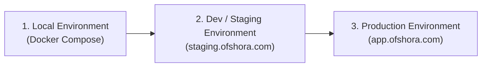

# Deployment, Infrastructure & 3rd-Party Integration Roadmap

This document outlines the environment tiers, external 3rd-party services, cloud hosting recommendations, and brand/domain strategy for **Ofshora** (formerly Offshora Energy OS). Use this document to review architecture and deployment decisions with your co-founder.

---

## 1. Executive Summary & Brand Strategy: "Ofshora"

### Domain Acquisition
* **Domain**: `ofshora.com`
* **Status**: **Acquired & Active** (Registered via Namecheap, Order #217696275).
* **Assessment**:
  * In the energy, maritime, and B2B oilfield sector, owning an exact `.com` domain delivers immediate credibility with IOC procurement desks (Chevron, Shell, TotalEnergies, NNPC), regulators (NUPRC, NMDPRA, NIMASA), and enterprise clients.
  * The single-"f" spelling ("Ofshora") is a crisp 7-letter brand that is easy to type, eliminates verbal spelling confusion ("is it one 'f' or two?"), and provides high brand recall.
  * **Routing Strategy**: All platform routes (`staging.ofshora.com`, `app.ofshora.com`, `api.ofshora.com`) are anchored on this domain. If `offshora.com` or `offshora.io` are ever acquired as defensive assets, configure them as 301 redirects to `ofshora.com`.

---

## 2. Three-Tier Environment Strategy

To support continuous delivery while strictly safeguarding production tenant data, the platform uses three distinct environment tiers:



| Dimension | 1. Local (Current) | 2. Dev / Staging | 3. Production |
| :--- | :--- | :--- | :--- |
| **Purpose** | Feature coding & automated test suites | Integration testing, client demos, co-founder QA | Live tenant operations & legal records |
| **Host / Domain** | `localhost:3000` / `localhost:8000` | `staging.ofshora.com` / `api-staging.ofshora.com` | `app.ofshora.com` / `api.ofshora.com` |
| **Database** | Containerized PostgreSQL 16 | Dedicated Managed PostgreSQL instance (isolated) | High-Availability Managed PostgreSQL + daily backups |
| **Row-Level Security** | Enabled (`petroledger_app` user) | Enabled & enforced | Enabled & enforced; zero superuser access |
| **3rd-Party Keys** | Sandboxes / Mock adapters | Test API keys (Bachs sandbox, Resend test mode) | Live production credentials & webhooks |
| **Storage Vault** | Local file volume / MinIO | S3 Bucket (staging partition) | S3 Bucket (versioned, encrypted at rest) |
| **Data Sanitization** | Synthetic seed fixtures | Sanitized test organizations | Strict multi-tenant isolation, real customer records |

---

## 3. Third-Party Services & Integrations Matrix

Here is the complete list of external services and integrations required across all 12 modules:

### A. Commercial & Financial Rail: Bachs (`bachs.io`)
* **Role**: Primary payment gateway for commercial invoices, bunkering nominations, haulage deposits, and EPC milestone settlements.
* **Why Bachs**:
  * **Dual-Currency Support**: Energy contractors operate in dual USD and NGN balance sheets. Bachs collects international cards, wire transfers, and local African rails (bank transfer, NIP).
  * **Stablecoins (USDT/USDC)**: Enables cross-border bunkering and marine spares settlement without local FX delays.
  * **Webhooks & Idempotency**: Native webhook event signing (`invoice.paid`, `charge.successful`) matching our `BillingInvoice` state machine.
* **Integration Checklist**:
  - [ ] Register organization account at [app.bachs.io](https://app.bachs.io).
  - [ ] Configure `BACHS_API_KEY` and `BACHS_WEBHOOK_SECRET` in environment variables.
  - [ ] Implement signature validation in `backend/billing/webhooks.py` to transition invoices from `issued` to `paid` or `partially_paid`.
  - [ ] Connect sandbox checkout session URLs to the frontend payment modal in `BillingDashboard.tsx`.

### B. Transactional Email & Notifications: Resend (`resend.com`)
* **Role**: Critical transactional messaging, statutory risk alerts, and authentication.
* **Use Cases**:
  * **SafePass HSE**: Emergency stop-work alerts and Permit-to-Work approval notifications.
  * **Compliance Shield**: 90/60/30/7-day statutory expiry warnings (NUPRC, NMDPRA, Cabotage, NIMASA, FIRS).
  * **Client Portal**: Magic link access tokens and SHA-256 sealed document delivery (BDNs, e-Waybills, Hydrotest certs).
  * **Billing**: PDF invoice dispatch and receipt delivery.
* **Integration Checklist**:
  - [ ] Create team account on Resend and verify domain DNS records (DKIM, SPF, DMARC on `ofshora.com`).
  - [ ] Set `RESEND_API_KEY` and configure Django email backend (`django-anymail[resend]`).
  - [ ] Create standardized HTML email templates using Tailwind/React Email.

### C. Secure Document Vault & Object Storage: S3-Compatible Storage
* **Role**: Immutable file storage for legal, safety, and operational evidence files.
* **Stored Assets**:
  * Bunkering: Signed Bunker Delivery Notes (BDNs) and sounding survey sheets.
  * Haulage: Scanned weighbridge slips and signed e-Waybill Proof of Delivery (POD).
  * SafePass: Scanned workforce medical fitness certificates, OPITO BOSIET certs, and JSA sign-offs.
  * PipeIntegrity & EPC-Link: Mill Test Certificates (MTC 3.1/3.2), NDT radiographic images, and hydrotest charts.
  * TankWorks: NESREA hazardous waste manifests and SSPC-PA 2 DFT inspection sheets.
* **Recommended Provider**: **DigitalOcean Spaces** or **Cloudflare R2** (Zero egress fees).
* **Integration Checklist**:
  - [ ] Provision bucket: `ofshora-vault-staging` and `ofshora-vault-prod`.
  - [ ] Enforce private buckets with signed, time-limited presigned URLs (expires in 15 minutes) served through backend permission checks.

### D. Telematics & SMS Gateway (Field Operations)
* **SMS / WhatsApp Gateway**: **Termii** (local Nigerian carrier routes for truck drivers) or **Twilio**.
  * Use case: RefineryLink holding-park e-Call-Up gate pass notifications sent directly to truck drivers' feature phones via SMS.
* **GPS / Telematics Integration (HaulTrac)**:
  * Ingestion webhook endpoint for onboard vehicle trackers (Traccar protocol or Teltonika / Geotab).
  * Allows automatic GPS geofence trip state advancement (`dispatched` → `in_transit` → `arrived_at_delivery`).

### E. Weighbridge & Depot Flow Meters (Edge Hardware)
* **Depot Flow Meter Tickets (RefineryLink)**:
  * AccuLoad / Smith Meter batch reconciliation.
  * In staging and early pilot: manual ticket verification with variance formula (<0.5%).
  * In enterprise production: On-premise serial/IP bridge daemon relaying batch tickets to `api.ofshora.com`.

---

## 4. Server & Cloud Hosting Evaluation

### Provider Comparison

| Provider | Pros | Cons | Verdict |
| :--- | :--- | :--- | :--- |
| **Hostinger** | • Low entry cost for basic web hosting. | • Weak VPC/networking isolation.<br/>• No managed PostgreSQL with RLS/SSL connection pooling.<br/>• Geared toward WordPress/PHP, not production enterprise Python/Django + Next.js clusters. | **Not Recommended** for an enterprise B2B energy operating system. |
| **DigitalOcean** *(Recommended for Launch)* | • **Managed PostgreSQL**: Automated daily backups, SSL enforcement, connection pooling, high availability.<br/>• **Spaces**: S3-compatible, built-in CDN, cheap.<br/>• **Droplets / App Platform**: Easy Docker Compose deployments.<br/>• Frankfurt / Amsterdam data centers provide high connectivity to Nigeria and Europe. | • Higher cost than raw bare-metal at very large scale. | **Strongly Recommended** for Local, Staging, and Initial Pilot Launch ($50–$150/mo). |
| **Hetzner Cloud** | • Unbeatable price-to-performance compute (CPX series in Germany/Finland). | • No managed database service (you must self-manage Postgres clustering, backups, and failover). | **Alternative** if you have a dedicated DevOps engineer managing database nodes. |
| **AWS / GCP** | • SOC 2, ISO 27001 certifications recognized by supermajors (Chevron, Shell).<br/>• Full enterprise KMS, RDS Aurora Postgres. | • High complexity, steep egress and managed services cost ($300–$800+/mo). | **Growth Phase**: Migrate when enterprise IOC enterprise tenders mandate dedicated SOC2 / AWS private VPCs. |

### Recommended Launch Architecture (DigitalOcean)

```
                              [ Cloudflare DNS & SSL ]
                                        │
           ┌────────────────────────────┴────────────────────────────┐
           ▼                                                         ▼
┌─────────────────────────────────┐       ┌─────────────────────────────────┐
│        Vercel (Frontend)        │       │    DigitalOcean 1GB Droplet     │
│  • Next.js 16 Edge / Serverless │       │  (Dedicated Backend API & DB)   │
│  • https://staging.ofshora.com  │       │  • Django Gunicorn (Port 8000)  │
│  • Automated Git CI/CD & CDN    │       │  • Celery Worker & Beat         │
│  • Zero compute cost on Droplet │       │  • Redis container (broker)     │
└─────────────────────────────────┘       │  • PostgreSQL 16 container (RLS)│
                                          │  • Caddy (SSL for api-staging)  │
                                          │  • https://api-staging.ofshora  │
                                          └────────────────┬────────────────┘
                                                           │
                                                           ▼
                                          ┌─────────────────────────────────┐
                                          │   Cloudflare R2 Bucket (Vault)  │
                                          │  • ofshora-vault-dev (10GB free)│
                                          │  • Zero egress fees             │
                                          └─────────────────────────────────┘
```

### Lean Bootstrap Architecture (Pre-Traffic / MVP Phase: $6 / month)

With the **frontend hosted on Vercel** and the **1GB Droplet dedicated strictly to the backend API, DB, and asynchronous workers**, memory pressure drops to almost nothing. 

The actual runtime RAM footprint on the droplet is extremely lean:
* **Django Gunicorn (2 lightweight workers)**: ~120 MB – 160 MB
* **Celery Worker (1 concurrency)**: ~60 MB – 80 MB
* **Redis container**: ~15 MB
* **PostgreSQL 16 container (Docker with RLS)**: ~60 MB – 90 MB
* **Caddy Reverse Proxy (HTTPS/TLS)**: ~25 MB
* **Total Runtime Memory Footprint**: **~280 MB – 370 MB**

#### Can the Backend run comfortably on a 1GB Droplet ($6/mo)?
**Yes, exceptionally well.**
* With only ~350 MB in use, the droplet has **over 600 MB of free headroom** at all times.
* The 2GB SSD swapfile gives extra peace of mind for any unexpected query or migration spikes.
* **No Next.js build overhead on the server**: Since Vercel builds and hosts the frontend, the droplet never has to run resource-heavy Node.js builds!

---

### Monthly Budget Comparison: Bootstrap vs Scaled Pilot

| Stage | Droplet Tier | Database | Object Storage | Total Cost / Month |
| :--- | :--- | :--- | :--- | :--- |
| **Tier 0: Ultra-Lean Bootstrap (Current)** | **1x 1GB Droplet ($6/mo)** with 2GB swap<br/>*(Or 1x 2GB Droplet @ $12/mo)* | Self-hosted Docker PostgreSQL with nightly `pg_dump` cron | Cloudflare R2 (10 GB free) or DO Spaces ($5/mo) | **$6 – $12 / mo** |
| **Tier 1: Pre-Pilot Staging & Prod** | **1x 2GB Droplet ($12/mo)** for Dev/Staging<br/>**1x 2GB Droplet ($12/mo)** for Prod | Self-hosted Docker PostgreSQL with automated remote backups | DigitalOcean Spaces ($5/mo) | **~$29 / mo** |
| **Tier 2: Enterprise Pilot (Paying IOC Clients)** | 1x 4GB Droplet ($24/mo) Prod<br/>1x 2GB Droplet ($12/mo) Staging | Managed DO PostgreSQL with automatic daily backups ($15–$30/mo) | DigitalOcean Spaces ($5/mo) | **~$60 – $80 / mo** |

> [!TIP]
> **Action Recommendation**: Start on **Tier 0 (Single 2GB Droplet @ $12/mo or 1GB @ $6/mo)** on DigitalOcean. Run all staging and internal demos on this single box. Do not spend a dime on managed database clusters or extra droplets until you are onboarding your first paying contractor.

---

## 5. Pre-Deployment Readiness & Action Checklist

### Phase 1: Immediate Decisions (Review with Co-founder)
- [x] **Domain**: Purchased `ofshora.com` on Namecheap (Order #217696275).
- [ ] **Hosting Account**: Create a team organization on DigitalOcean.
- [ ] **Payment Merchant Account**: Register at [bachs.io](https://bachs.io) to obtain sandbox and live API credentials.
- [ ] **Email Service**: Register at [resend.com](https://resend.com) and add DNS records for `ofshora.com`.

### Phase 2: Staging Deployment (Approved: 1GB Droplet + 2GB Swap + Cloudflare R2)
- [ ] Provision DigitalOcean Basic Droplet ($6/month, 1 vCPU, 1 GB RAM, 25 GB NVMe, Ubuntu 24.04 LTS).
- [ ] Configure 2GB SSD swapfile and set `vm.swappiness=10`.
- [ ] Configure DNS records on Cloudflare:
  * `staging.ofshora.com` → Droplet IP
  * `api-staging.ofshora.com` → Droplet IP
- [ ] Provision Cloudflare R2 Bucket: `ofshora-vault-dev` (10 GB free tier, S3-compatible, $0 egress).
- [ ] Deploy containerized PostgreSQL 16 + Redis + Celery + Django + Next.js + Caddy via Docker Compose.
- [ ] Run database migrations and seed initial test tenant organizations.
- [ ] Configure automated daily `pg_dump` backup cron syncing database snapshot to Cloudflare R2.
- [ ] Execute smoke test across all 12 modules on `staging.ofshora.com`.

### Phase 3: Pilot & Production Gate
- [ ] Provision high-availability Production PostgreSQL cluster with automated daily backups.
- [ ] Switch Bachs and Resend keys from Sandbox to Live.
- [ ] Configure encrypted S3 bucket permissions for document evidence vault.
- [ ] Perform client onboarding for first commercial pilot contractor.
